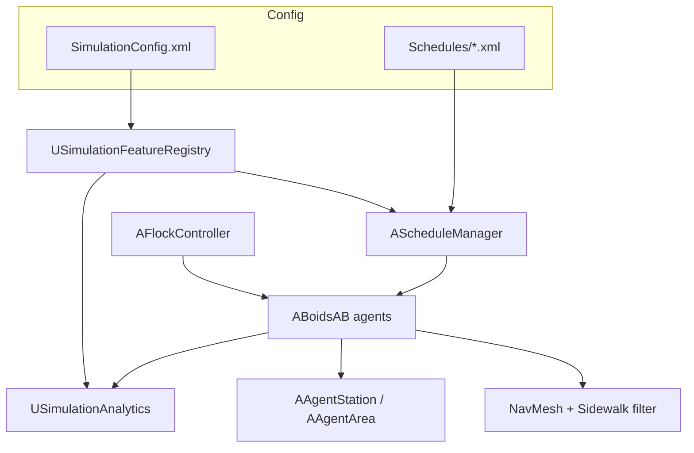

# Project Overview

## What this is

Pedestrian crowd sim in Unreal Engine 5.4. Agents are `ACharacter` (`ABoidsAB`) — local flocking plus NavMesh path following. Day-to-day routines come from XML schedules. Stations (desks, counters, beds, etc.) have capacity and queues. Three scenarios sit on that stack: emergency evacuation, daily urban life, and a mall A/B layout comparison. Smaller validation maps (`V01`–`V06`) are there for simpler flow checks.

Logic lives in the `Thesis` C++ module. Feature toggles are in `Config/SimulationConfig.xml`, applied at runtime by `USimulationFeatureRegistry`.

## Goals vs content

What we were aiming for, and where it ended up:

| Aim | In the project |
|-----|----------------|
| Evacuation under time pressure | `Evacuation.umap`, `AEmergencyManager`, exits, CSV |
| Authorable daily routines | `DailyUrbanLife.umap`, schedule XML, homes/desks |
| Compare two mall layouts | `MallA` / `MallB`, infrastructure + V&V export |
| Local crowd motion | `ABoidsAB`, `AFlockController` |
| Goal-directed paths | NavMesh + sidewalk filter |
| Simple flow experiments | `V01`–`V06`, on-screen stats panel |

## Architecture sketch



Most gameplay logic ends up on the agent. The registry decides which managers and subsystems are allowed to run for the current map. Schedules push commands; flocking and navigation shape how those commands look in motion.

## Main pieces

| Area | Main types | Notes |
|------|------------|--------|
| Agents | `ABoidsAB`, `AFlockController` | Motion and flock parameters |
| Schedules | `AScheduleManager` | Clock + XML rules |
| Stations | `AAgentStation`, `AAgentArea` | Capacity and queues |
| Decision layers | Needs, priority, fallback components | Hunger/energy and conflict handling |
| Navigation | NavMesh, sidewalk area/filter | Path queries |
| UC1 | Emergency / incident / exits / routing | Evacuation |
| UC2 | `ADailyUrbanLifeManager` | Destinations, offsets, speeds |
| UC3 | Infrastructure + V&V managers | Mall metrics and comparison |
| Optional demos | Leadership, cops/robbers | Off in the baseline config |
| Metrics | `USimulationAnalytics`, validation panel | CSV and on-screen stats |

## Stack

Unreal Engine **5.4**, C++ (`Thesis` module), `XmlParser`, `NavigationSystem`, `AIModule`, `EnhancedInput`, UMG (widgets such as `WBP_Evacuation` / `WBP_DailyLife`). The `.uproject` also enables ModelingToolsEditorMode for editor-only work.

## Layout of the repo

```
Project/
├── Config/                 SimulationConfig.xml, engine ini
├── Content/UseCases/       Evacuation, DailyUrbanLife, MallA/B, Validation
├── Documentation/          This guide set
├── Schedules/              XML itineraries (also copied under Saved/)
├── Source/Thesis/          C++ module (AI, Emergency, Simulation, …)
└── Thesis.uproject
```

Exported CSVs go under `Saved/Analytics/` after a run that actually triggers export.
