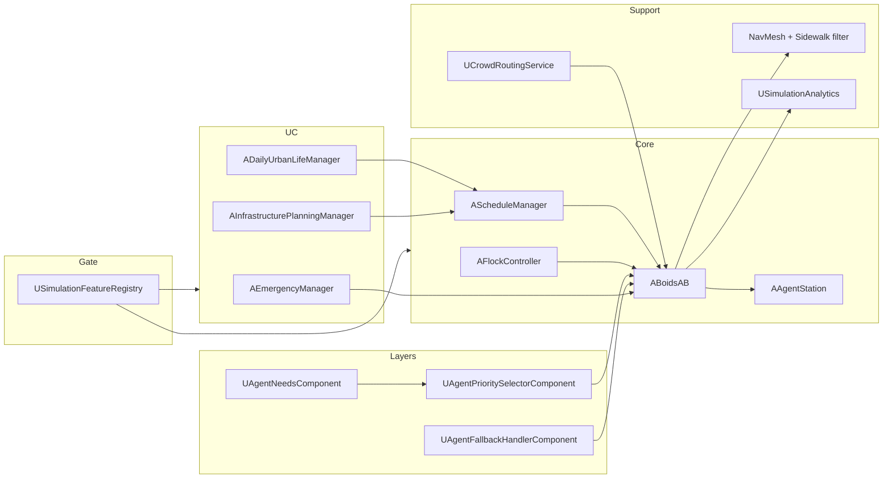

# System Architecture

C++ side of the runtime. Blueprint wiring and actor placement live in the binary maps—open the level in the editor if you need exact placement.

## How the pieces hang together

## Agents and flocking

`ABoidsAB` is the pedestrian. `AFlockController` holds shared weights and speeds; it does not tick the crowd itself.

In normal play an agent registers with the flock, steers with separation / alignment / cohesion / avoidance, and follows waypoint lists from NavMesh queries. While MoveTo is active, flock forces can be blended in as a **lateral** offset on path progress (`bEnableSteeringWhileMoving`) so the corridor does not get abandoned for pure flocking.

States on the agent include `Normal`, `Fleeing`, `Exiting`, `MovingToSafeZone`, `EvacuationSuccess`, and `Casualty`.

Waypoint advance uses both horizontal distance and feet height against the path point. That matters on stairs and multi-floor meshes: XY-only advance would skip elevated samples. Look-ahead along a segment is done in the horizontal plane so steep chords do not reverse agents back up a stair.

## Schedules

`AScheduleManager` owns the sim clock, loads XML, registers agents by id (`Agent_0`, …), and fires rules when due. Station occupation can defer a rule. Targets for MoveTo / UseStation are resolved through actor tags and areas. Spawners can assign per-agent schedule overrides.

Clock detail used in UC2 comments: about one real second per schedule minute.

There is still an older `ARuleParser` in the tree with hard-coded external paths. Active schedules for the use cases go through ScheduleManager.

## Needs, priority, fallback

`UAgentNeedsComponent` tracks hunger (up) and energy (down) with critical thresholds. `UAgentPrioritySelectorComponent` orders layers from panic/emergency down through needs, crime, leadership, scheduled tasks, then idle flock. `UAgentFallbackHandlerComponent` reacts to bad paths, stuck agents, queues, and missing destinations (retry, alternate POI, wait, skip, idle, go home, and similar).

When a higher layer owns the agent, schedules can be deferred (for example while following a leader).

## Stations

`AAgentArea` groups stations and can be marked closed. `AAgentStation` has capacity, a FIFO queue, timed use after the occupant has physically arrived, and optional animation / pose settings.

`UseStation` from XML can be one step or a pipeline (counter then table, for example). Timing starts on `NotifyOccupantReached`, not merely when a path is requested.

## Navigation

Paths come from `FindPathToLocationSynchronously` with `UNavFilter_SidewalkOnly`. Sidewalk areas (`UNavArea_Sidewalk`) are cheap; other areas are heavily penalised. Agents follow the resulting points with Character Movement. Optional NavMesh snap corrects XY if the agent drifts off mesh.

Evacuation exit choice scores distance and congestion via `UCrowdRoutingService` and `UCongestionAnalyzer`. Other routing modes exist on the enum but evacuation is the path that is fully wired for exit selection.

## Leadership and crime (optional)

Leadership: `UAgentLeadershipComponent` plus `ALeadershipDemoManager` when the feature is on. Followers can override schedules if configured.

Cops and robbers: `UAgentCrimeRoleComponent` and `ACopsAndRobbersDemoManager`. Baseline config keeps this feature off.

## Evacuation

`AEmergencyManager` and `AIncidentManager` start and end the global phase. `AExitPoint` handles capacity and queue slots. `AEvacuationSafeZone` is a tagged safe destination. Agents flee after a reaction delay, may switch exits under congestion rules, and may become casualties if that option is enabled. Metrics export covers evacuations, casualties, reassignments, and per-exit throughput.

## Analytics and validation

`USimulationAnalytics` holds snapshots and CSV writers for evacuation, daily life, infrastructure, crime, and validation sampling. Daily-life export exists as an API but the UC2 manager does not call it automatically at session end. Validation has a live panel and no CSV writer. Mall A vs B comparison files are produced by `AVerificationValidationManager` when both infrastructure CSVs are available.

## Feature registry

`USimulationFeatureRegistry` is the gate for Evacuation, Leadership, CopsAndRobbers, InfrastructureAnalysis, DailyUrbanLife, and ValidationStats. After config load, map-name gates adjust those flags (malls turn infrastructure on and daily life off; validation maps turn validation stats on).

| Use case | Managers | Typical schedule | Metrics |
|----------|----------|------------------|---------|
| UC1 | Emergency + Incident | Level setup | Evacuation CSV |
| UC2 | DailyUrbanLifeManager | `DailyUrbanLifeSchedule.xml` | Live snapshot |
| UC3 | Infrastructure (+ V&V) | Mall A/B XML | Infrastructure CSV + comparison |
| Validation | Map gate + panel | `Schedules/Validation/*` | On-screen only |
