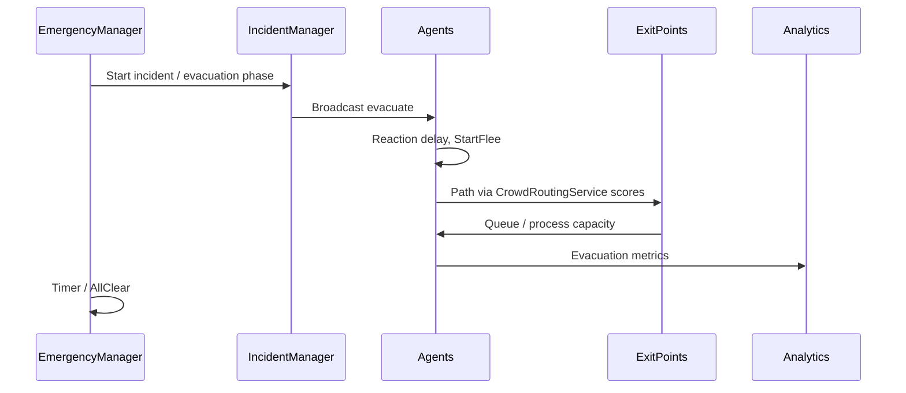

# Use Cases

Three scenarios sit on the same agent stack. Which managers run is controlled by `USimulationFeatureRegistry` and `SimulationConfig.xml`, with some maps flipping flags by name.

## Use Case 1 — Emergency Evacuation

The evacuation map (`Content/UseCases/Evacuation.umap`) is meant to show a timed emergency: agents flee, pick exits with distance and congestion in mind, queue at capacity-limited exits, and may reach safe zones or become casualties.

Unlike the daily-life and mall maps, evacuation is **not** turned on just by the map name. `enableEvacuation` must be true in config (it is in the project baseline), and the level needs `AEmergencyManager`, `AIncidentManager`, exits, agents, and usually a flock controller. Safe zones are optional.

Rough flow: the manager starts the phase; agents wait out their reaction delay, then flee; exit scores mix distance and congestion; agents can be reassigned a limited number of times; exits process queue slots; the timer and casualty options follow the `<evacuation>` block in config. A finished session can write `Saved/Analytics/Evacuation_<timestamp>.csv`.

Tunables include radius, weights, reevaluation interval, switch threshold, max reassignments, reaction delay range, duration, timer start delay, speed variation, and casualty / celebration flags. Any on-screen controls in `WBP_Evacuation` are Blueprint-side.

In play you should see schedules stop for evacuating agents, flee/exit motion instead of idle flocking, and analytics reflecting throughput, queues, timer state, and reassignments when congestion actually triggers switches.

## Use Case 2 — Daily Urban Life

Map: `DailyUrbanLife.umap`. Schedule: `DailyUrbanLifeSchedule.xml` (path configurable). The DailyUrbanLife feature is off in the clean baseline config but turns on automatically when the map name contains `DailyUrban`, `UrbanLife`, or `DailyLife`.

`ADailyUrbanLifeManager` picks the schedule, wires home/work/food from tags, applies small minute offsets and walking-speed ranges, warns if expected tags are missing, and starts analytics sampling.

The authored day is compressed: **home → commute → work desk → break → work → home** (and in the current schedule, some agents also use Sleep/Bed stations). Work areas are `Work0`–`Work6` with desks `A0`–`A24`. Homes are `Home1`–`Home25`. Agents 0–24 own desks; 25–49 reuse them and will queue. Breaks use `Trigger` with `id="Break"` toward a plaza tag (default `Plaza`).

If needs are enabled, hunger and energy move over time (scaled by `needsRateScale`). Critical needs can interrupt through the priority layer; scheduled home return can still win when `homeReturnOverridesNeeds` is set.

Leadership is a separate optional feature and is not required for the baseline day schedule. Casual greetings from `UPedestrianInteractionComponent` may pause agents briefly.

Worth checking in a run: staggered starts, queues on shared desks, break behaviour (plaza or in-place fallback), and snapshot fields on analytics. Daily-life CSV export exists on the analytics subsystem but is not fired automatically when the UC2 manager ends a session.

## Use Case 3 — Urban Infrastructure Planning

This use case compares two mall layouts with the same pedestrian code.

| Layout | Map | Schedule | Auto service capacity |
|--------|-----|----------|------------------------|
| Mall A (tighter food service) | `MallA.umap` | `InfrastructurePlanningSchedule_MallA.xml` | 1 |
| Mall B (two food courts) | `MallB.umap` | `InfrastructurePlanningSchedule_MallB.xml` | 2 |

Opening a mall map forces infrastructure analysis on and daily urban life off. With `autoSelectFromMap`, schedule and capacity follow A vs B. Mall A comments describe one food court and counter→table pipelines; Mall B splits load across `FoodCourt` and `FoodCourt2`.

Agents shop, run multi-stage food service, sit, and exit. Queues and NavMesh paths (stairs included) are where layout differences show up. At the end of a run, infrastructure CSVs land under `Saved/Analytics/`. When both A and B CSVs exist, the V&V manager can write a comparison CSV and a short text summary with checklist lines (metrics present, wait/congestion hypotheses, and so on).

Numbers always depend on how many agents you spawn and how the mesh and stations were placed in each map. Empirically, Mall A tends to pressure shared counters harder; Mall B spreads that load—confirm on your own runs rather than treating the hypothesis text as a unit test.
