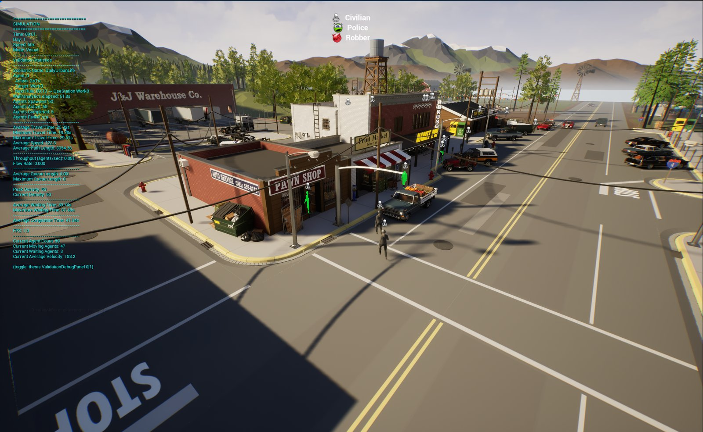
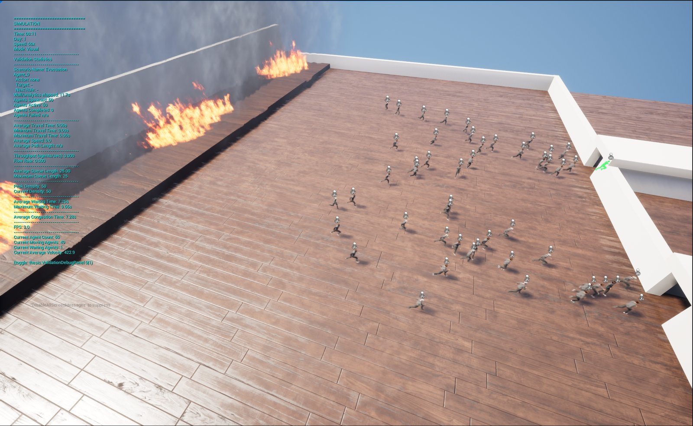
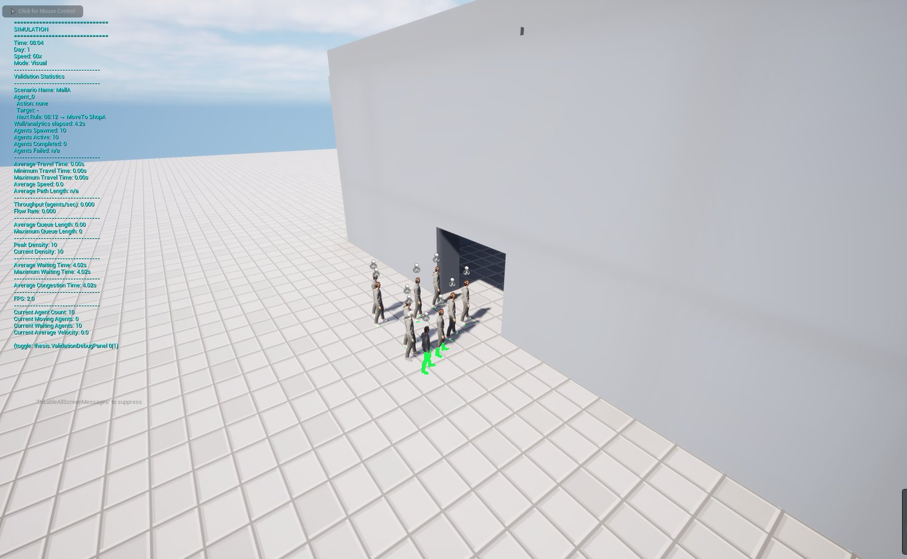
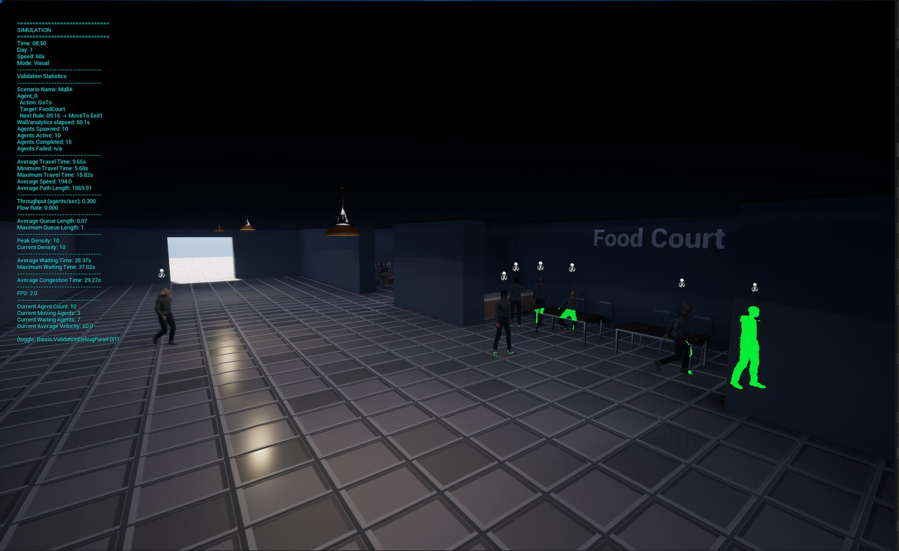
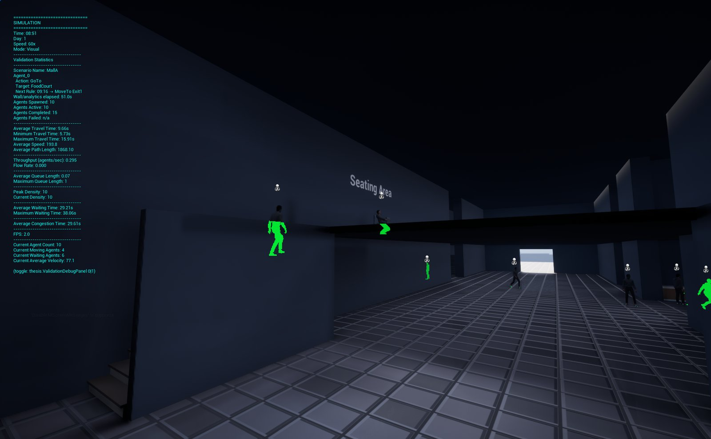
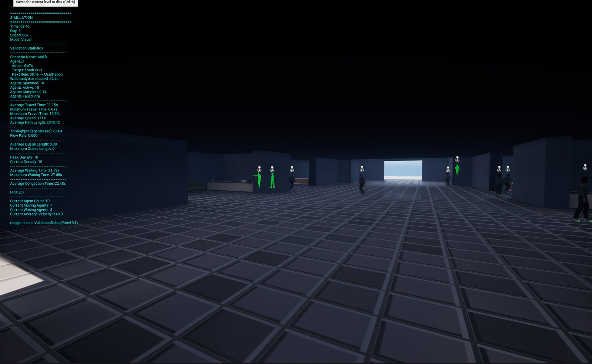
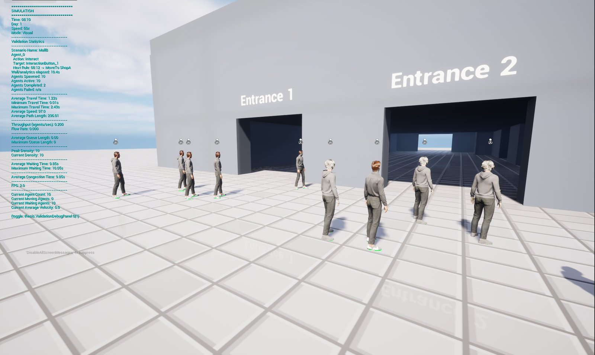
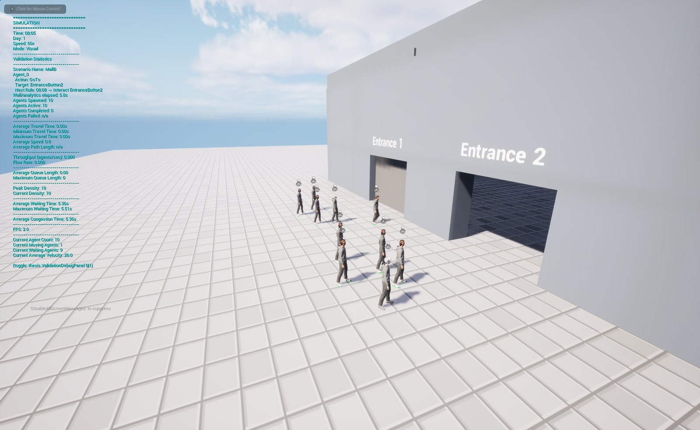

# Boid Animation Rule System

A pedestrian crowd simulation framework built in Unreal Engine 5.4 as part of a master's thesis by Rui Armada.

Agents are `ACharacter` actors (`ABoidsAB`) that combine local flocking with NavMesh path following. Their daily routines are written as XML schedules, and stations such as desks, counters and beds have a capacity and a queue. Three scenarios are built on this stack: an emergency evacuation, a day of urban life and an A/B comparison of two shopping mall layouts. Seven small validation maps cover basic flow cases such as a bottleneck, a corner and a T-junction.

## Repository layout

```
Masters-Thesis/
├── Thesis/                          Unreal Engine 5.4 project
│   ├── Thesis.uproject
│   ├── Source/Thesis/               C++ module (agents, schedules, stations, scenarios, analytics)
│   ├── Config/                      SimulationConfig.xml (simulation settings)
│   ├── Content/
│   │   ├── Blueprints/              Agent, spawner, flock and incident blueprints, animation blueprint
│   │   └── UseCases/                Scenario and validation maps with their blueprints and widgets
│   ├── Schedules/                   XML schedules for each scenario
│   │   └── Validation/              XML schedules for the validation maps
│   └── Documentation/               Technical guide (Markdown chapters and the compiled PDF)
├── media/screenshots/               Screenshots used in this README
├── LICENSE
└── README.md
```

## Scenarios and maps

| Scenario | Map | Schedule |
|----------|-----|----------|
| Emergency evacuation | `/Game/UseCases/Evacuation` | `Schedules/EvacuationSchedule.xml` |
| Daily urban life | `/Game/UseCases/DailyUrbanLife` | `Schedules/DailyUrbanLifeSchedule.xml` |
| Infrastructure planning (Mall A and Mall B) | `/Game/UseCases/UrbanPlanning/MallA` and `MallB` | `Schedules/InfrastructurePlanningSchedule_MallA.xml` and `_MallB.xml` |
| Mall entrance demo | `/Game/UseCases/UrbanPlanning/EntranceDemo` | `Schedules/InfrastructurePlanningSchedule_MallEntranceInteract.xml` |
| Validation (V01 to V07) | `/Game/UseCases/Validation/V0*` | `Schedules/Validation/*.xml` |

## Screenshots

<table>
  <tr>
    <td width="50%"><br>Daily Urban Life</td>
    <td width="50%"><br>Emergency evacuation</td>
  </tr>
  <tr>
    <td><br>Mall A entrance</td>
    <td><br>Mall A food court</td>
  </tr>
  <tr>
    <td><br>Mall A multi-level layout</td>
    <td><br>Mall B interior</td>
  </tr>
  <tr>
    <td><br>Mall B entrances</td>
    <td><br>Agents moving to open an entrance (interact action)</td>
  </tr>
</table>

## Videos

Screen recordings of each scenario are attached to the [Demo videos release](https://github.com/RuiArmada/Masters-Thesis/releases/tag/videos).

| Scenario | Video |
|----------|-------|
| Daily urban life | [daily-urban-life.mp4](https://github.com/RuiArmada/Masters-Thesis/releases/download/videos/daily-urban-life.mp4) |
| Emergency evacuation | [evacuation.mp4](https://github.com/RuiArmada/Masters-Thesis/releases/download/videos/evacuation.mp4) |
| Infrastructure planning, Mall A | [mall-a.mp4](https://github.com/RuiArmada/Masters-Thesis/releases/download/videos/mall-a.mp4) |
| Infrastructure planning, Mall B | [mall-b.mp4](https://github.com/RuiArmada/Masters-Thesis/releases/download/videos/mall-b.mp4) |
| Validation, unidirectional | [validation-unidirectional.mp4](https://github.com/RuiArmada/Masters-Thesis/releases/download/videos/validation-unidirectional.mp4) |
| Validation, bidirectional | [validation-bidirectional.mp4](https://github.com/RuiArmada/Masters-Thesis/releases/download/videos/validation-bidirectional.mp4) |
| Validation, corner | [validation-corner.mp4](https://github.com/RuiArmada/Masters-Thesis/releases/download/videos/validation-corner.mp4) |
| Validation, bottleneck | [validation-bottleneck.mp4](https://github.com/RuiArmada/Masters-Thesis/releases/download/videos/validation-bottleneck.mp4) |
| Validation, T-junction | [validation-t-junction.mp4](https://github.com/RuiArmada/Masters-Thesis/releases/download/videos/validation-t-junction.mp4) |
| Validation, functional area | [validation-functional-area.mp4](https://github.com/RuiArmada/Masters-Thesis/releases/download/videos/validation-functional-area.mp4) |

## Third-party content (not included)

The maps and the agent blueprint use art and animation from third-party packs. Their licences do not allow redistribution in a public repository, so they are not part of this repository and the project will not run until they are added. Each pack must be placed in `Thesis/Content/` under the exact folder name below, because the assets reference it by path. These folders are listed in `.gitignore` so they are never committed by accident.

| Folder in `Thesis/Content/` | Source | Used by |
|-----------------------------|--------|---------|
| `MetaHumans/` (`Amelia`, `Cooper`, `Common`) | MetaHuman characters exported from Quixel Bridge | Agent blueprint `BPBoidsAB` and the `S_CharPresets` structure |
| `Characters/Mannequins/` | Epic Third Person template | Agent blueprint and jump animations |
| `NPCManager/` | Third-party animation pack | Agent blueprint and the Daily Urban Life map |
| `SocialNPCAnimations/` | Third-party animation pack | Agent blueprint and the Mall A and Mall B maps |
| `AssetsvilleTown/` | Third-party city environment pack | Daily Urban Life, Mall A, Mall B and V06 maps, car prop, animation assets |
| `M5VFXVOL2/` | Third-party VFX pack (Niagara fire) | Fire blueprint `BP_Fire` in the evacuation scenario |
| `StarterContent/` | Epic Starter Content | Two wood materials (`M_Wood_Floor_Walnut_Worn`, `M_Wood_Walnut`) in the evacuation map |

The Starter Content and the Third Person mannequins can be added from the editor with **Add > Add Feature or Content Pack**. The other packs come from Fab or Quixel Bridge under their own licences.

## Requirements

- Unreal Engine 5.4
- Visual Studio 2022 with the "Game development with C++" workload (the `Thesis/.vsconfig` file lists the exact components)
- Windows 64-bit (the setup guide assumes Win64 and the Development Editor configuration)

## Building and running

1. Clone the repository and add the third-party content listed above.
2. Right-click `Thesis/Thesis.uproject` and choose **Generate Visual Studio project files**.
3. Build the `ThesisEditor` target in the Development Editor configuration for Win64, or open the `.uproject` and let the editor compile the module.
4. Open one of the maps from the table above in the Content Browser and press Play.

The simulation settings are in [`Thesis/Config/SimulationConfig.xml`](Thesis/Config/SimulationConfig.xml). At load this file is copied to `Saved/Config/SimulationConfig.xml` when that copy is missing or older, and local overrides belong in the `Saved` copy. Every option is described in the [configuration guide](Thesis/Documentation/08_Configuration.md). The engine `.ini` files in `Config/` are not tracked, because the editor generates them on first launch. Run results such as evacuation and mall metrics are exported as CSV files to `Saved/Analytics/`. The validation statistics panel is toggled with the console command `thesis.ValidationDebugPanel 1`.

## Documentation

The full technical guide is in [`Thesis/Documentation`](Thesis/Documentation):

1. [Project overview](Thesis/Documentation/01_Project_Overview.md)
2. [Setup guide](Thesis/Documentation/02_Setup_Guide.md)
3. [System architecture](Thesis/Documentation/03_System_Architecture.md)
4. [XML guide](Thesis/Documentation/04_XML_Guide.md)
5. [Use cases](Thesis/Documentation/05_Use_Cases.md)
6. [Validation and verification](Thesis/Documentation/06_Validation_and_Verification.md)
7. [Debug panel](Thesis/Documentation/07_Debug_Panel.md)
8. [Configuration](Thesis/Documentation/08_Configuration.md)
9. [API and classes](Thesis/Documentation/09_API_and_Classes.md)
10. [Extending the project](Thesis/Documentation/10_Extending_the_Project.md)
11. [Known limitations](Thesis/Documentation/11_Known_Limitations.md)

The same chapters are compiled into [`Boid_Pedestrian_Simulation_Documentation.pdf`](Thesis/Documentation/Boid_Pedestrian_Simulation_Documentation.pdf) by `build_pdf.py`, which needs Pandoc, the Mermaid CLI (`mmdc`) and Google Chrome.

## License

The source code, maps, blueprints, schedules and documentation in this repository are released under the [MIT License](LICENSE). The third-party content listed above is not covered by this licence and remains under the terms of its respective owners.
